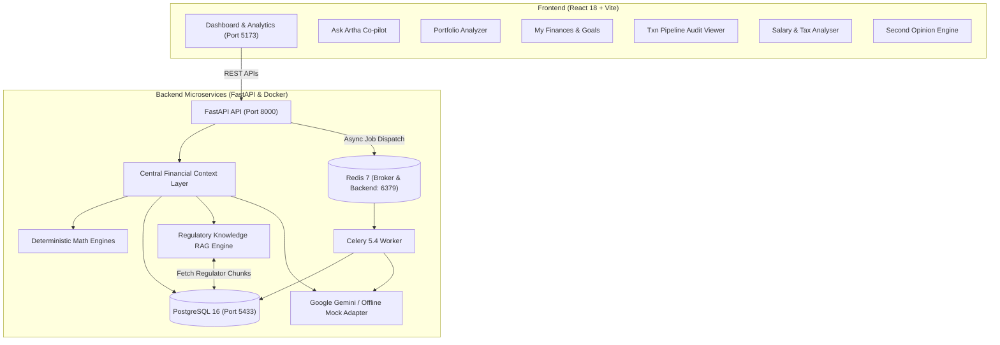

# 🪙 Artha — AI-Powered Personal Financial Co-Pilot & Portfolio Intelligence Platform

> **An India-first, AI-powered personal financial co-pilot that understands a user's financial situation, uses trusted regulatory information, performs deterministic calculations, and helps them make better-informed financial decisions.**

[](https://fastapi.tiangolo.com)
[](https://react.dev)
[](https://vitejs.dev)
[](https://www.postgresql.org)
[](https://redis.io)
[](https://docs.celeryq.dev)
[](https://ai.google.dev)

---

## 💡 Core Philosophy

Unlike typical wrappers where questions are blindly routed to an LLM:

$$\text{User Data} + \text{Deterministic Calculations} + \text{Trusted Knowledge (RAG)} + \text{AI Reasoning} = \textbf{Artha}$$

- **Calculations are 100% deterministic**: Net surplus, emergency fund adequacy, debt burden (DTI), SIP projections, portfolio returns, and 100-point financial health scores are calculated using pure Python math — never hallucinated by an LLM.
- **Explicit Assumptions**: All projections (SIP compounding, retirement gaps) clearly label assumed return rates (e.g., 10%–12% CAGR) as educational scenarios, not predictions.
- **Authoritative Indian Knowledge**: Grounded in authentic regulatory standards from **SEBI, RBI, Income Tax Department, AMFI, IRDAI, and PFRDA**.

---

## 🏗️ System Architecture



* **Architecture Diagram (PNG)**: [View on Google Drive](https://drive.google.com/file/d/1rLvq-jEkvLnd0F_5IEMLN-Rhn2B1OkRI/view?usp=sharing)
* **Draw.io Source Diagram (.drawio)**: [View on Google Drive](https://drive.google.com/file/d/1dV-NBipXqWkxxd7tbpF_5SCe3MxWW9Dk/view?usp=drive_link)

---

## 🌟 Key Features

### 1. 📊 Central Financial Profile & Dashboard
- Consolidated overview of monthly salary, essential vs. discretionary expenses, rent, active loan EMIs, and liquid savings.
- Transparent 100-point **Financial Health Score** based on 5 pillars: Savings Surplus, Emergency Buffer, Debt Burden, Protection Cover, and Investment Footprint.
- Real-time visual progress tracking for active financial goals.

### 2. 🤖 Grounded "Ask Artha" Co-pilot
- Contextual financial decision-support answering questions like:
  - *"I earn ₹30,000/month and have ₹8,000 surplus. Where should I start investing?"*
  - *"Can I afford a ₹15,000 car loan EMI?"*
  - *"Why did my travel spending increase this month?"*
- Displays transparent breakdowns: **What Artha Knows**, **Deterministic Calculations**, **Authoritative Sources Cited**, and **Explicit Assumptions**.

### 3. 📈 Portfolio Analyzer & Asset Allocation
- Multi-asset tracking across **Stocks, Mutual Funds, ETFs, PPF, NPS, Gold, and Cash/FD**.
- Calculates invested capital, current valuation, absolute gain/loss, and overall percentage return.
- Visual asset allocation breakdown with automated concentration risk warnings (flagging any asset representing $>30\%$ of the portfolio).
- Pluggable `MarketDataService` interface ready for live market API integration.

### 4. 📚 Regulatory Knowledge Base & Lightweight RAG
- Curated guidance from authentic Indian regulators:
  - **SEBI**: Mutual fund categorization & direct vs. regular plan expense ratio (0.5%–1.5% TER) savings.
  - **RBI**: 3–6 month emergency liquidity guidelines, sweep-in accounts, and debt safety thresholds ($<40\%$ DTI).
  - **Income Tax Department**: FY 2025–26 slabs, ₹75,000 standard deduction under New Regime, Section 80C/80D, and July 2024 capital gains rules (STCG 20%, LTCG 12.5%).
  - **AMFI**: Rupee cost averaging and the power of compounding via disciplined SIPs.
  - **IRDAI**: Pure Term Life coverage standards (10x–15x annual income) vs. high-commission endowment policies.
  - **PFRDA**: National Pension System (NPS) Tier-1 structure & exclusive ₹50,000 Section 80CCD(1B) deduction.

### 5. ⚡ Asynchronous Transaction Pipeline & Audit
- Ingests raw bank/credit card CSV statements.
- Cleans data, normalizes formats, and deduplicates identical transactions using content-based row hashing.
- Statistical anomaly detection flagging outliers ($>3\times$ median category spend) and unexpected foreign currency (FX) charges.
- **Cross-Job Persistent Merchant Cache**: `MerchantCategoryCache` stores merchant classifications in PostgreSQL across uploads and users, saving $>90\%$ of LLM calls at scale.
- Generates structured narrative summaries and syncs cleaned spend directly into the user's monthly budget profile.

### 6. 💼 Salary & Tax Analyser (FY 2025–26)
- Dynamic comparison between the **Old vs. New Tax Regimes**.
- Computes monthly take-home, income tax slabs, EPF deduction, and HRA exemption rules.

### 7. 🛡️ Second Opinion (Insurance Policy Pitch Auditor)
- Analyzes traditional endowment policies (e.g., LIC Jeevan plans) and ULIPs.
- Calculates realistic IRR ($\sim4.5\% - 5.5\%$), reveals hidden first-year agent commissions (up to $35\%$), and provides a mathematically superior alternative: Pure Term Life Insurance + Nifty 50 Index Mutual Funds.

---

## 📂 Project Layout

```text
artha/
├── artha-txn-pipeline/               # 🐍 Backend (Python / FastAPI / Celery / Docker)
│   ├── app/
│   │   ├── api/
│   │   │   ├── routes.py             # Complete REST API endpoints
│   │   │   └── schemas.py            # Pydantic request/response models
│   │   ├── core/
│   │   │   ├── config.py             # Environment settings & configuration
│   │   │   └── db.py                 # SQLAlchemy engine & session manager
│   │   ├── models/
│   │   │   └── __init__.py           # PostgreSQL models (Profile, Goals, Holdings, Chunks, Jobs)
│   │   ├── services/
│   │   │   ├── context_layer.py      # Central Financial Context aggregator
│   │   │   ├── financial_math.py     # Pure Python deterministic math & health scorecard
│   │   │   ├── portfolio_math.py     # Portfolio analytics & concentration detection
│   │   │   ├── rag.py                # Regulatory knowledge base & search engine
│   │   │   ├── cleaner.py            # CSV cleaning & deduplication
│   │   │   ├── anomaly.py            # Outlier & FX anomaly detection
│   │   │   └── llm.py                # Gemini integration & offline mock fallback
│   │   ├── workers/
│   │   │   ├── celery_app.py         # Celery task configuration
│   │   │   └── tasks.py              # process_job background execution pipeline
│   │   └── main.py                   # FastAPI app entrypoint & startup handlers
│   ├── tests/
│   │   ├── test_financial_math.py    # Unit tests for financial calculations
│   │   └── test_portfolio_math.py    # Unit tests for portfolio analytics
│   ├── docker/                       # Dockerfiles for API and Celery workers
│   ├── docker-compose.yml            # Multi-container orchestration (API, Worker, Redis, Postgres)
│   ├── requirements.txt              # Backend dependencies
│   └── transactions.csv              # Sample 95-row test statement
│
├── frontend/                         # ⚛️ Frontend (React 18 / Vite)
│   ├── src/
│   │   ├── App.jsx                   # Main single-page application dashboard
│   │   ├── App.css / index.css       # Clean design system & styling
│   │   └── main.jsx                  # React DOM entrypoint
│   ├── package.json                  # Frontend dependencies
│   └── vite.config.js                # Vite development server configuration
│
└── README.md                         # Project documentation
```

---

## 🚀 Quickstart Guide

### Prerequisites
- [Docker Desktop](https://www.docker.com/products/docker-desktop/)
- [Node.js](https://nodejs.org/) (v18+) or [Bun](https://bun.sh/)
- [Python 3.11+](https://www.python.org/) *(for running backend locally outside Docker)*

---

### Step 1: Start the Backend (Docker Compose)

```bash
cd artha-txn-pipeline
docker compose up --build -d
```

- **API Server**: `http://localhost:8000` (or `http://127.0.0.1:8000`)
- **Swagger Documentation**: `http://localhost:8000/docs`
- **PostgreSQL**: `localhost:5433` (database: `txn_db`, user: `txn_user`)
- **Redis**: `localhost:6379`

> **Note on LLM Configuration**: By default, `.env` runs with `LLM_PROVIDER=mock`, meaning the entire system — categorization, narrative synthesis, and Co-pilot — runs **100% offline with zero cost and no API keys required**. To use real Gemini intelligence, simply set:
> ```env
> LLM_PROVIDER=gemini
> GEMINI_API_KEY=your_gemini_api_key_here
> ```

---

### Step 2: Start the Frontend

```bash
cd ../frontend
npm install
npm run dev
```

Open `http://localhost:5173` in your browser.

---

### Step 3: Explore with One-Click Demo Data

1. On the bottom of the left sidebar, click **⚡ Load Demo Profile**.
2. This instantly populates:
   - A salaried profile (₹30,000 salary, ₹16,000 expenses, ₹35,000 emergency fund).
   - Goals (Emergency Buffer, Higher Education).
   - Investment holdings (Nifty 50 Index Fund, PPF, Sovereign Gold Bond).
   - Regulatory knowledge chunks from SEBI, RBI, and Income Tax Department.
3. Switch between tabs:
   - **Dashboard**: Explore the 100-point Financial Health score gauge and cash flow metrics.
   - **Ask Artha**: Ask any financial question and review the cited sources and assumptions.
   - **Portfolio**: View asset allocations and concentration risk insights.
   - **Txn Pipeline**: Upload `transactions.csv` to see the asynchronous Celery pipeline audit in action.

---

## 🧪 Running Automated Tests

Run backend unit tests for deterministic math engines:

```bash
cd artha-txn-pipeline
pytest tests/
```

Verify frontend build integrity:

```bash
cd ../frontend
npm run build
```

---

## ⚖️ Disclaimer

*Artha provides educational financial decision-support based on deterministic calculations and publicly available regulatory guidelines. It does not provide guaranteed investment returns or replace a SEBI-registered Investment Adviser (RIA). Always verify major financial decisions with a certified professional.*

---

## 👨‍💻 Author

**Aarya Dharmadhikari**  
GitHub: [@aarya0044](https://github.com/aarya0044)
